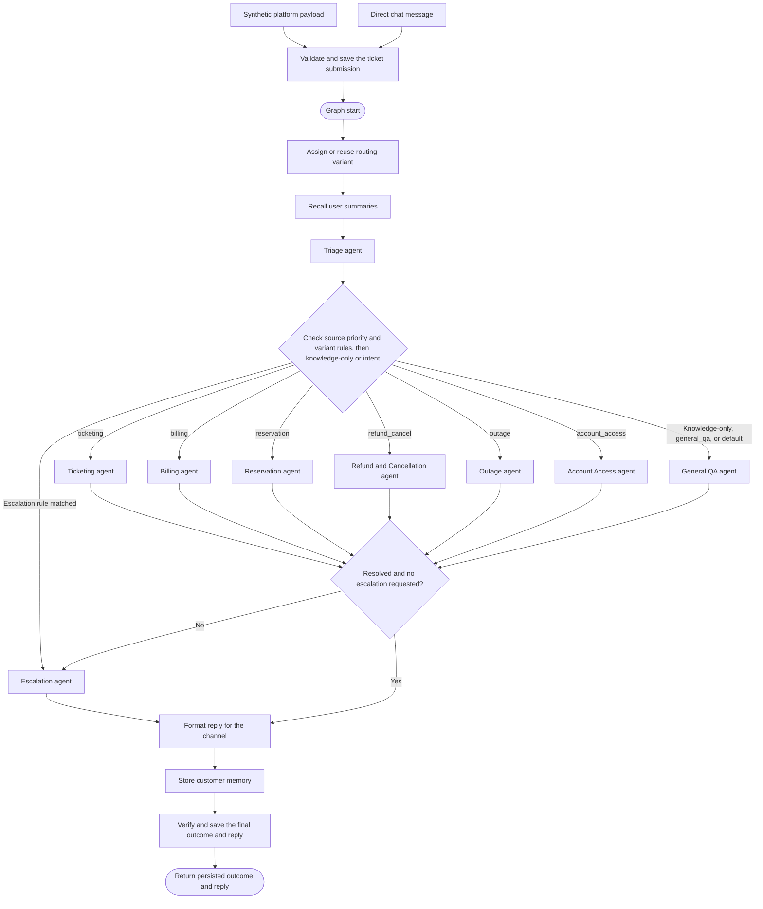

# UDA-Hub Multi-Agent Architecture

## 1. Architecture pattern

UDA-Hub uses a **centralized router** pattern. Triage classifies each customer message once. LangGraph uses that classification, source priority, and the ticket's routing variant to select one domain specialist or send the ticket directly to Escalation. The specialist handles its domain using tools and returns a structured outcome. LangGraph then uses that outcome to decide whether to escalate or format the reply.

The workflow is implemented in [`workflow.py`](../workflow.py). Specialists use local LangChain tools backed by the UDA-Hub and CultPass SQLite databases, a synthetic outage feed, or ChromaDB. The repository also includes a [FastMCP server](../tools/cultpass_mcp.py). The current graph binds the local tools directly.

## 2. End-to-end flow

The notebook's chat interface calls [`submit_ticket`](../ticket_processing.py), which normalizes and validates the input, saves the ticket and customer message, and streams the graph updates. Reuse the same ticket ID to resume a conversation and use a new ticket ID with the same customer identifier to start another ticket. The channel formatter and memory writer run on both the specialist resolution path and the escalation path.

## 3. Agent responsibilities

Each domain specialist receives Triage's `rewritten_query`. Where shown below, the workflow also passes the identifiers available in shared state. All seven specialists return `response`, `resolved`, `needs_escalation`, and an optional `escalation_reason`. The response becomes the draft reply, and the outcome flags drive the next routing decision.

| Agent | Inputs | Responsibility | Outputs |
| --- | --- | --- | --- |
| [Triage](../agents/triage_agent.py) | Latest customer message, channel, current date, and recalled summaries when available | Classify the primary support intent, assess urgency and sentiment, identify knowledge-only requests, and rewrite the request | `TriageDecision` with intent, sentiment, urgency, confidence, reasoning, rewritten query, and `knowledge_only` |
| [Ticketing](../agents/ticket_agent.py) | Rewritten query, ticket ID, and user identifier if available | Look up ticket status and conversation history. Update ticket metadata or add a message when appropriate. | Ticket status, history, or update result in the specialist outcome |
| [Billing](../agents/billing_agent.py) | Rewritten query and user ID or email if available | Look up subscription tier, status, and monthly quota. Handle plan changes through the billing tool. | Subscription answer or plan-change result in the specialist outcome |
| [Reservation](../agents/reservation_agent.py) | Rewritten query and user ID or email if available | Browse experiences, check bookings, and book an available experience | Availability, reservation details, or booking result in the specialist outcome |
| [Refund and Cancellation](../agents/refund_agent.py) | Rewritten query and user ID or email if available | Handle reservation and subscription cancellations and use the threshold-gated refund tool | Cancellation or simulated refund result, or a reason for human review |
| [Outage](../agents/outage_agent.py) | Rewritten query | Read the synthetic incident feed and report service status and recovery estimates when available | Incident status and customer guidance in the specialist outcome |
| [Account Access](../agents/access_agent.py) | Rewritten query and user ID or email if available | Check account status, troubleshoot access, and handle permitted unblock or email-update requests | Account guidance, action result, or a reason for human review |
| [General QA](../agents/general_qa_agent.py) | Rewritten query | Retrieve support articles from ChromaDB and verify that each selected passage appears in its cited article | Article excerpts with source titles and IDs, or a request for human help |
| [Escalation](../agents/escalation_agent.py) | Original customer message, escalation reason, sentiment, urgency, intent, and ticket ID if available | Select a human support team, prepare an internal summary, and attempt to record the handoff locally | Structured handoff details and a customer reply. The graph uses the reply as its draft and marks the state for escalation. |

Refund and access approval checks live inside their respective tools. A refund above the default $50 limit or an unblock request with a risk score above 0.40 returns an escalation signal. The specialist translates that signal into a structured outcome, and the shared post-specialist routing rule sends the ticket to Escalation.

## 4. State, routing, and outputs

### Input and shared state

`normalize_platform_payload` handles synthetic Zendesk, Intercom, and Freshdesk payloads, plus generic email, chat, and social media input. It maps the text to a `HumanMessage` and extracts the channel, user ID or email, ticket ID, and source priority where available. The adapter produces graph state. Ticket updates later in the workflow apply to records that already exist.

`TicketState` carries messages, ticket identifiers, recalled memory, the Triage decision, tool names and execution statuses, the draft response, and resolution flags. The `add_messages` reducer combines messages across invocations. LangGraph's `SqliteSaver` saves the full conversation and workflow state by `thread_id` in `data/core/workflow_memory.sqlite3`. Use `orchestrator.get_state(config)` to inspect current messages and tool history, or `get_state_history(config)` to inspect intermediate checkpoints. Set `UDAHUB_MEMORY_DB_PATH` to use a different database.

The SQLite store in the same file keeps a record of resolved issues and preferences explicitly stated by the customer. Stored preferences contain verified quotes from the customer's message and are updated by category. The memory namespace comes from a hash of the customer ID or email. Without a customer identifier, the store scopes memory to the current thread.

Triage receives the latest message, recent turns, and saved issues and preferences. Domain specialists receive the rewritten request and saved context, and use the original customer identifier for tool lookups. Triage clears the previous turn's outcome fields before routing the new message.

### Routing decisions

The adapter normalizes incoming priority to `low`, `normal`, `high`, or `critical`. It maps `medium` to `normal` and `urgent` to `critical`. It also accepts Freshdesk's integer priorities 1–4 and maps Intercom's `priority` flag to `high`. Missing or unrecognized values leave source priority unspecified. [Freshdesk ticket properties](https://developers.freshdesk.com/api/#ticket_properties) · [Intercom priority labels](https://developers.intercom.com/docs/references/preview/changelog)

Triage infers urgency from the latest customer message and available context. After classification, a `critical` source priority sends the ticket directly to Escalation in either variant and supplies the reason “Source ticket priority is critical.” Escalation also receives the classified intent to help select the human team.

For other priorities, the graph applies the rules below. It honors a supplied routing variant and otherwise assigns one deterministically from the ticket ID or thread ID.

| Variant | Direct escalation rule | Route otherwise |
| --- | --- | --- |
| A | Confidence below 0.75 or angry sentiment | Route knowledge-only requests to General QA, otherwise select by primary intent |
| B | Confidence below 0.60, or angry sentiment combined with critical urgency for an intent other than outage | Route knowledge-only requests to General QA, otherwise select by primary intent |

After a specialist runs, the graph escalates when `needs_escalation` is true or `resolved` is false. Otherwise it sends the specialist's draft to the formatter. For general policy, FAQ, and how-to questions, General QA retrieves articles before selecting evidence and uses only verified excerpts in the reply. It requires cosine similarity of at least 0.25 and escalates if all retrieved candidates fall below that cutoff. The state records candidate scores and the verified source article IDs for the turn. For customer-specific lookups and operations, domain specialists use their operational tools.

### Response and ticket outcome

The formatter adds an email greeting and sign-off, trims social media replies to 280 characters, or returns the trimmed chat draft. Escalation assigns a support team from the classified intent and records a handoff in the ticket database. The submission service verifies the handoff note before reporting an escalation, and it saves the final ticket metadata, customer reply, and outcome event in one transaction. Rejected submissions skip Triage. A processing failure records the stage and error type and returns a failure response.

### Audit trail

The `ticket_events` table in the core database records timestamped submissions, classifications, routes, retrieval evidence, tool calls, resolution attempts, handoffs, failures, and final outcomes. Use `query_ticket_events` to filter by ticket ID, run ID, event type, node, status, or tool name. Each submitted turn gets a run ID to distinguish it from earlier activity on the same ticket.

## 5. Worked examples

The Triage values and reply text below illustrate expected behavior. Ticket status updates assume the supplied ticket ID matches an existing record.

| Input | Example Triage decision | Graph path | Expected output |
| --- | --- | --- | --- |
| Generic email payload with a CultPass user ID asking “How many experiences are included in my monthly quota?” with Variant A | Intent `billing`, sentiment `neutral`, urgency `medium`, confidence `0.93` | Triage → Billing → Channel Formatter → Memory Write | Billing looks up the subscription and replies with the plan's quota. The email starts with “Hello,” and ends with “CultPass Support Team.” Ticket status becomes `resolved`. |
| Chat message “Something is wrong. Can you help?” with Variant B | Intent `general_qa`, sentiment `neutral`, urgency `medium`, confidence `0.40` | Triage → Escalation → Channel Formatter → Memory Write | Escalation prepares a human handoff and returns a chat reply such as “I've forwarded your request to our support team for review.” Ticket status becomes `escalated`. |

The [routing demo notebook](../../03_agentic_app.ipynb) traces three sample tickets in Variant A. Changing the quota question's priority from normal to critical switches the route from Billing to Escalation. Changing the normal-priority ticket's text to an event availability question routes it to Reservation.

The same notebook includes a knowledge retrieval demo for billing proration, venue check-in, and an unsupported gift-card question. It prints the retrieved article titles and distances, verified source IDs, graph path, and reply. The unsupported question must reach General QA and then Escalation because the retrieved articles cannot answer it.

The persistent-memory demo runs two turns, closes and reopens an isolated SQLite database, and inspects the original thread's messages and subscription lookup history. It then shows a new ticket for the returning customer using a saved reply preference and a second customer's ticket using the default reply style.

The notebook's end-to-end demo verifies two successful resolutions, a saved knowledge-gap handoff, rejection of a blank message, and a provider failure. It queries the audit trail and checks the final ticket records in an isolated SQLite database.
